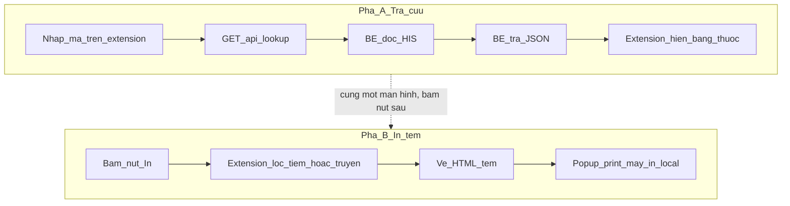

# MedLabel — Phân tích luồng hoạt động (BE ↔ FE)

Tài liệu dành cho người đọc code / vibe-code: hiểu **dữ liệu đi đâu**, **file nào chịu trách nhiệm**, và **ranh giới BE–FE**. Không phải hướng dẫn thao tác điều dưỡng.

Hai repo:

|     | Path thường dùng    | Vai trò                                           |
| --- | ------------------- | ------------------------------------------------- |
| BE  | `MedLabel`          | HTTP + query HIS Postgres                         |
| FE  | `MedLabelExtension` | Chrome MV3 side panel + HTML tem + `window.print` |

---

## 1. Bức tranh toàn cảnh

Hệ thống có **hai pha tách nhau**. Không phải bấm Tra cứu xong là in ngay.

### Pha A — Tra cứu (lấy dữ liệu)

1. Người dùng nhập mã trên side panel (extension).
2. Extension gọi BE: `GET /api/lookup?ma-ho-so=…` hoặc `?ma-benh-an=…`.
3. BE hỏi Postgres HIS: tìm đợt điều trị → lấy các dòng thuốc của đợt đó.
4. BE xử lý thêm trong RAM: gắn thuốc dùng kèm vào thuốc chính, nhóm theo tờ điều trị.
5. BE trả JSON (`patient` + `orders[]`).
6. Extension kiểm tra `apiVersion`, rồi hiện bảng thuốc trên UI. **Chưa in.**

### Pha B — In tem (sau khi người dùng bấm nút In)

1. Extension lọc từ JSON đã có: dòng tiêm / dòng truyền (bỏ thuốc dùng kèm làm tem riêng).
2. Extension tự vẽ HTML tem (khổ giấy cuộn).
3. Mở cửa sổ popup → `window.print()` → máy in gắn máy trạm.

BE không tham gia pha B. BE không biết tem trông thế nào; extension không chạy SQL.



---

## 2. Ranh giới trách nhiệm

| Việc                                     | Ở đâu                                                     | Vì sao                                  |
| ---------------------------------------- | --------------------------------------------------------- | --------------------------------------- |
| Credential Postgres                      | BE `.env`                                                 | `.crx` / `dist/` ai unzip cũng đọc được |
| SQL, parse mã, nhóm phiếu, gắn thuốc kèm | BE `src/db/lookup.ts`                                     | Một nguồn query                         |
| Shape JSON                               | BE `src/contracts/lookup.v1.ts` → FE `yarn sync:contract` | Hai repo không share import             |
| Đường dùng nào được in                   | FE `src/lib/routes.ts`                                    | BE cố ý trả **mọi** dòng thuốc active   |
| Layout tem, cặp số, thuốc pha trên giấy  | FE `src/lib/labels.ts`                                    | Đổi tem = release extension             |
| Máy in                                   | FE local                                                  | Server không trả PDF                    |

Khi vibe-code: muốn đổi chữ trên tem → FE. Muốn thêm field từ HIS → BE contract + query + sync FE. Muốn “chỉ in hôm nay” → quyết định BE (filter SQL) hay FE (filter sau khi nhận) — hiện tại **không** filter ngày ở đâu cả.

---

## 3. Luồng BE — từ request đến JSON

Entry: `src/server/index.ts` → `handleLookup` (`lookup-route.ts`) → `lookupByMaHoSo` / `lookupByMaBenhAn` (`db/lookup.ts`).

### 3.1. Resolve đợt điều trị

```
mã → his_patienthistory (isdeleted=N, isactive=Y)
```

- **Mã hồ sơ:** `his_patientdocument` = 10 digit `YYMMDD` + STT. Unique → `matchCount = 1`. Có thêm `dateHint`.
- **Mã bệnh án:** `his_medicalrecordno`. Có thể nhiều đợt → lấy `ORDER BY timegoin DESC`, `matchCount` = số đợt trùng.

Không dùng `value` (mã NB) làm fallback — dễ nhầm với mã hồ sơ.

### 3.2. Load dòng thuốc

```
his_service_product
  LEFT JOIN his_product, his_methoduse, his_dosage, c_uom
WHERE his_patienthistory_id = ?
  AND isdeleted = N AND isactive = Y
ORDER BY docdate, actdate, seqno
```

Không filter đường dùng, không filter ngày, không filter đã phát kho. Mọi dòng active của đợt đều vào JSON.

### 3.3. Thuốc dùng kèm (in-memory)

HIS: dòng kèm có `ref_service_union_id` = `his_service_union_id` của dòng chính.

BE không self-join SQL (cột `ref_*` không index). Sau khi fetch:

1. `attachAccompanyingDrugs` — đẩy `{ hisServiceProductId, tenThuoc }` vào `thuocDungKem` của dòng chính; set `laThuocDungKem = true` trên dòng kèm.
2. `groupIntoOrders` — nhóm theo `createdfromrecord_id` (= tờ điều trị), sort phiếu mới trước.

Orphan `ref` (không tìm thấy cha) giữ dòng standalone, không nuốt thuốc.

### 3.4. Response shape (ý tưởng)

```
{
  apiVersion: 1,
  lookupBy, matchCount, orderCount, medicationCount,
  patient: { maHoSo, maBenhAn, tenNb, tuoi, ngaySinh, ... },
  orders: [{
    toDieuTriId, thoiGianKe, medicationCount,
    medications: [{
      tenThuoc, lieuDung, duongDung, ...,
      laThuocDungKem, thuocDungKem: [...]
    }]
  }]
}
```

BE **không** gắn cờ “là tiêm” / “là truyền”. Chỉ trả `duongDung` text từ catalog.

---

## 4. Luồng FE — từ JSON đến tờ tem

### 4.1. Nhận mã và gọi API

| File                | Việc                                                                        |
| ------------------- | --------------------------------------------------------------------------- |
| `sidepanel/main.ts` | Form, render phiếu, mở dialog in                                            |
| `lib/code-kind.ts`  | 10 số ngày hợp lệ → `ma-ho-so`, còn lại → `ma-benh-an`                      |
| `lib/api.ts`        | `fetchLookup` + `parseLookupResponse` — **fail cứng** nếu `apiVersion` lệch |
| `settings.ts`       | Origin server (default `http://medlabel.local:8080`)                        |

### 4.2. Lọc dòng in được

`lib/routes.ts`:

| Hàm                                       | Rule                                             |
| ----------------------------------------- | ------------------------------------------------ |
| `isInjectableRoute`                       | trim, `/^tiêm/i`, và **không** match `/truyền/i` |
| `isInfusionRoute`                         | chứa `/truyền/i`                                 |
| `injectablesInOrder` / `infusionsInOrder` | thêm `!laThuocDungKem`                           |

Hai filter **không chồng**. Uống / YHCT thang vẫn nằm trong bảng UI nhưng không vào job in.

### 4.3. Build HTML tem

`lib/labels.ts` — khổ cố định: ô 52×22 mm, hàng 104×22 mm (`@page`).

| Loại   | Geometry                                    | Nội dung chính                                                                                                            |
| ------ | ------------------------------------------- | ------------------------------------------------------------------------------------------------------------------------- |
| Tiêm   | 1 thuốc / 1 ô; chunk 2 ô/hàng; ô lẻ trống   | tên thuốc, thuốc pha, tên NB, tuổi, mã BA                                                                                 |
| Truyền | 1 thuốc / **cả hàng** (trái 1/2 + phải 2/2) | trái: NB, năm sinh, Điều dưỡng trống, giờ in; phải: thuốc, pha, `lieuDung` làm tốc độ; cả hai: số cặp đậm + mã BA `- n/2` |

`thuocDungKem[].tenThuoc` nối bằng `+`. Tốc độ truyền = `lieuDung` (`his_usage`), **không** dùng `tocDoTruyen`.

Số cặp: 1-based trong **một print job**; hai nửa cùng số. In riêng một thuốc → số = 1.

### 4.4. Print pipeline

Chrome side panel **không** chạy `window.print()` đáng tin.

1. `print-job.ts` — ghi job vào `chrome.storage.session`, mở popup `src/print/index.html?job=…`.
2. `print/main.ts` — `takePrintJob` (đọc một lần rồi xóa), render HTML, `print()`, `afterprint` đóng cửa sổ.
3. Job có thể là một kind (`injection` | `infusion`) hoặc `sections[]` (tiêm trước, truyền sau).

Máy in = driver Windows trên máy trạm; BE không tham gia bước này.

---

## 5. Contract giữa hai repo

1. Source of truth: BE `src/contracts/lookup.v1.ts` (không import gì).
2. FE copy: `yarn sync:contract` → header sha256; pre-commit `check:contract` chặn sửa tay.
3. Runtime: mọi response có `apiVersion`; FE mismatch → không render / không in.

Additive field optional vẫn giữ v1. Breaking → `lookup.v2` + bump version + release FE đồng bộ.

---

## 6. File map nhanh (điểm vào khi debug)

### BE (`MedLabel`)

```
src/server/index.ts        HTTP router, timeout, /health, /updates
src/server/lookup-route.ts parse query, gọi lookup, wrap JSON
src/db/lookup.ts           SQL + attachAccompanyingDrugs + groupIntoOrders
src/db/pool.ts             pg Pool
src/contracts/lookup.v1.ts shape API
```

### FE (`MedLabelExtension`)

```
src/sidepanel/main.ts      UI tra cứu + dialog in
src/lib/api.ts             HTTP + guard apiVersion
src/lib/routes.ts          tiêm / truyền / bỏ thuốc kèm
src/lib/labels.ts          HTML/CSS tem
src/lib/print-job.ts       session job + mở popup
src/print/main.ts          render + print
src/contracts/lookup.v1.ts GENERATED — đừng sửa tay
```

---

## 7. Quyết định thiết kế hay “mắc” khi đọc code

1. **BE trả rộng, FE lọc hẹp** — một JSON phục vụ bảng + nhiều loại tem; tránh nhân bản rule đường dùng trong SQL.
2. **Thuốc kèm ghép in-memory** — tránh scan bảng lớn trên `ref_service_union_id`.
3. **Tem truyền = 2 ô / 1 thuốc** — trái hành chính, phải thuốc; số cặp to để ghép sau khi bóc.
4. **Không filter ngày trên BE** — phiếu cũ vẫn xem được; nếu sau này cần “chỉ hôm nay”, đổi có chủ đích.
5. **In qua popup** — hạn chế Chrome side panel, không phải “bug tạm”.

---

## 8. Tài liệu sâu hơn

| File                                     | Khi nào mở                                |
| ---------------------------------------- | ----------------------------------------- |
| [ARCHITECTURE.md](ARCHITECTURE.md)       | Chi tiết field in ra tem, update CRX, DNS |
| [HIS_DB_MEDLABEL.md](HIS_DB_MEDLABEL.md) | Cột HIS, thuốc dùng kèm, index            |
| [DEPLOYMENT.md](DEPLOYMENT.md)           | Cài Windows / policy Chrome               |
| README từng repo                         | Script dev, bảng endpoint                 |
